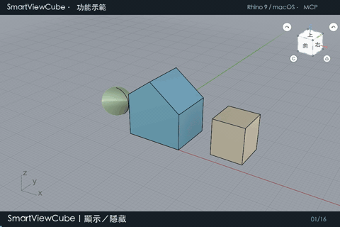

## 繁體中文

本次更新提供 **macOS／Windows × Rhino 7、8、9** 的獨立套件。

### 更新內容

- ViewCube 指令改為 `SmartViewCube`，並提供淺／深色立方體圖示及 SmartView 工具列。
- 旋轉改為圓弧動畫，避免鏡頭途中突然推近再退回。
- 單選以物件包圍盒中心旋轉；多選以整組包圍盒中心旋轉；未選取則使用目前視圖目標點。
- 減少動畫更新堆積、重複攝影機設定與繪圖暫存配置。
- 保留面／邊／角切換、平行／透視、返回視角、C 工作平面跟隨、Focus／Flip／Back。

| Rhino | macOS | Windows |
| --- | --- | --- |
| 7 | `rhino7-mac.macrhi` | `rh7_0-win.yak` 或 `rhino7-windows-rhp.zip` |
| 8.35+（.NET 8） | `rhino8-mac.macrhi` | `rh8_35-win.yak` 或 `rhino8-windows-rhp.zip` |
| 9（.NET 10） | `rhino9-mac.macrhi` | `rh9_0-win.yak` 或 `rhino9-windows-rhp.zip` |

完整檔名另含 `0.2.0-beta.1`。Rhino 9 套件以 SDK 9.0.26300.9402 編譯，需要使用 .NET 10 的 Rhino 9。

Windows ZIP：完整解壓縮，使用對應 Rhino 的 `PlugInManager` →「安裝」→ `ononSmartView.rhp`。Yak 請使用該 Rhino 的 Yak CLI，不要當模型開啟。Mac 請使用正確主版本的 Rhino 開啟 `.macrhi`。先移除舊副本並重啟，避免重複安裝。工具列／快捷鍵巨集使用 `_SmartViewCube`。

**此為測試版本，仍有疏漏、不足及未驗證之處。** 三個目標編譯均為零警告、零錯誤，封存完整性檢查通過。近期功能曾於 Mac Rhino 9 透過 MCP 操作驗證，GIF 使用 beta.6 功能；本次新發布檔的實機回歸測試仍待完成，Rhino 7／8 與所有 Windows 執行情況尚未驗證。Rhino 7 沒有 Rhino 8 Auto CPlane；C 僅跟隨手動／世界工作平面改變。

[中文完整說明](https://github.com/ZionW/ononSmartView/blob/main/README.zh-TW.md)

## English

This release provides separate packages for **macOS / Windows × Rhino 7, 8 and 9**.

### Changes

- Renames the ViewCube command to `SmartViewCube`; adds light/dark cube icons and the SmartView toolbar.
- Uses an orbit arc to prevent the camera moving inward and outward during rotation.
- Uses the selected object's bounding-box center, or the combined center for multiple selections. With no selection, it uses the current viewport target.
- Reduces queued animation updates, repeated camera assignments and temporary drawing allocations.
- Retains face/edge/corner navigation, parallel/perspective switching, saved-view return, CPlane following and Focus / Flip / Back.

Download the filename matching your Rhino major version. Rhino 7 uses .NET Framework 4.8 / Mono; Rhino 8.35+ uses .NET 8; the Rhino 9 build targets SDK 9.0.26300.9402 and requires .NET 10.

Windows manual installation: extract the matching `rhinoN-windows-rhp.zip` into a permanent folder and use `PlugInManager` > Install > `ononSmartView.rhp`. Alternatively use that Rhino version's Yak CLI for its `.yak`. Open the macOS `.macrhi` with the intended Rhino major version. Remove older copies and restart before installation. Toolbar / keyboard macro: `_SmartViewCube`.

**Experimental release: known gaps and unverified behavior remain.** All three builds completed with zero warnings/errors, and archive integrity checks passed. Recent feature checks were performed via MCP in Mac Rhino 9; the GIF demonstrates beta.6 functionality. Runtime regression testing of these exact release binaries is pending, including Rhino 7/8 and all Windows packages. Rhino 7 has no Rhino 8 Auto CPlane; C follows manual / World CPlane changes only.

The release also includes the 20-second full-resolution GIF, MP4, source ZIP, standalone toolbar and SHA-256 checksums.

[English instructions](https://github.com/ZionW/ononSmartView/blob/main/README.md)
