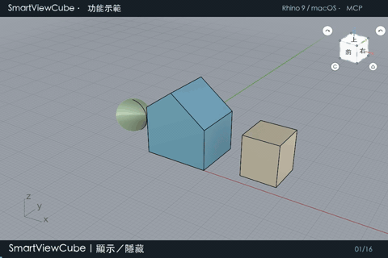

# ononSmartView

**Experimental viewport navigation for Rhino 7, 8 and 9 · macOS / Windows**
[繁體中文](README.md) · [Download v0.2.0-beta.1](https://github.com/ZionW/ononSmartView/releases/tag/v0.2.0-beta.1)

> **TEST VERSION — incomplete and subject to change.** Known gaps and unverified behavior remain. This release was built separately for each Rhino major version. Recent interaction checks and the demonstration were performed in macOS Rhino 9; the new Rhino 7/8 binaries and all Windows binaries have not been tested in their target Rhino applications. Save important models before trying it.

## 20-second demonstration



Actual Mac Rhino 9 viewport captures, operated through MCP commands and plug-in callbacks, with Traditional Chinese captions. Demonstrates show/hide, drag rotation, selected-object orbit, face/edge/corner snaps, projection switching, view reset, CPlane following, and Focus / Flip / Back on planar and curved faces. The GIF is silent and loops. [Full-resolution GIF and MP4](https://github.com/ZionW/ononSmartView/releases/tag/v0.2.0-beta.1).

## Choose your package

| Rhino | Target runtime | macOS | Windows |
| --- | --- | --- | --- |
| 7 | .NET Framework 4.8 / Mono, AnyCPU | `rhino7-mac.macrhi` | `rh7_0-win.yak` or `rhino7-windows-rhp.zip` |
| 8.35+ | .NET 8, AnyCPU | `rhino8-mac.macrhi` | `rh8_35-win.yak` or `rhino8-windows-rhp.zip` |
| 9 with .NET 10 | .NET 10, AnyCPU | `rhino9-mac.macrhi` | `rh9_0-win.yak` or `rhino9-windows-rhp.zip` |

Rhino 9 packages are built against SDK 9.0.26300.9402 and require a .NET 10 Rhino 9 build. Package filename suffixes are shown above; complete filenames include the release version. **Install only the package matching the Rhino version you intend to use.** Older Rhino 8 builds and early Rhino 9 WIP builds using older .NET runtimes are not covered.

## Features

- Focus a Brep face: set a face CPlane and animate to a face-on parallel view. Planar faces use a plane; curved faces use a tangent frame at the pick point.
- Back restores the pre-focus camera, projection, target, lens and CPlane. Flip reverses the focused viewing direction.
- ViewCube face, edge and corner clicks snap the view and switch parallel / perspective projection. Drag to orbit; use the arrow buttons for 90° turns.
- Orbit animation follows an arc rather than moving through the model. Rotation keeps its orbit radius and lens settings. Selecting one object uses its bounding-box center; multiple selected objects use the combined bounding-box center. With no selection, the current viewport target is used. This selection pivot applies to ViewCube dragging and its rotation buttons.
- The home icon returns Perspective to the view saved before the current ViewCube session. Standard named views return to their default direction and frame visible objects.
- The circular **C** button enables/disables camera alignment with CPlane changes. Clicking C changes the setting only. When disabled, selecting objects or changing the CPlane does not trigger plug-in camera alignment. It does not change Rhino's Auto CPlane preference.
- Rhino 7 has no Rhino 8 Auto CPlane. Its C toggle follows manual / World CPlane changes.
- The SmartView toolbar includes a custom light/dark cube icon for showing or hiding the ViewCube.

## Commands

| Command | Action |
| --- | --- |
| `SmartViewCube` | Show / hide ViewCube. Replaces the old `ononSmartViewCube` command. |
| `ononSmartView` | Pick a Brep face and focus it. |
| `ononSmartViewFlip` | Reverse the focused view. |
| `ononSmartViewBack` | Restore the pre-focus camera and CPlane. |
| `ononSmartViewAutoFace` | Toggle CPlane following, equivalent to C. |
| `ononSmartViewFocusFace` | Scriptable focus: Brep GUID, zero-based face index and viewport name. |

Toolbar / keyboard macro: `_SmartViewCube`. Update existing shortcuts that use the previous command name.

## Install on macOS

1. Download the `.macrhi` for your Rhino major version from [Releases](https://github.com/ZionW/ononSmartView/releases/tag/v0.2.0-beta.1).
2. Quit that Rhino version, remove an older copy of this plug-in, and open the installer with the intended Rhino application (use **Open With** if several Rhino versions are installed).
3. Restart Rhino. Run `SmartViewCube` to toggle the overlay.

The installer is unsigned. The bundle includes `ononSmartView.rui`. In Rhino 8/9, open it from toolbar settings and show the **SmartView** toolbar if it is not already visible. Toolbar customization differs in Rhino 7 for Mac; use the command or assign `_SmartViewCube` to a keyboard shortcut there.

## Install on Windows

**Manual RHP installation** is available for Rhino 7, 8 and 9:

1. Download the matching `rhinoN-windows-rhp.zip` and extract it into a permanent local folder.
2. If Windows Properties offers **Unblock**, unblock the downloaded archive/files.
3. Run `PlugInManager` in the matching Rhino version, choose **Install**, and select the extracted `ononSmartView.rhp`. Do not load directly from the ZIP or move the folder afterwards.
4. Open `ononSmartView.rui` in toolbar settings if you want the icon button.

Alternatively, install the matching `.yak` from PowerShell. For Rhino 7:

```powershell
& "$env:ProgramFiles\Rhino 7\System\Yak.exe" install "C:\Downloads\ononsmartview-0.2.0-beta.1-rh7_0-win.yak"
```

Replace `Rhino 7` and the package path for Rhino 8 or 9. A `.yak` is a package, not an RHP or model file; use Yak CLI if dragging it into Rhino reports an unsupported type. Remove an older installation and restart Rhino before switching between Yak and manual installation, to avoid duplicate copies.

## Build and packaging

Source is included in this repository and the versioned source ZIP. Use the .NET 8 SDK for Rhino 8, the .NET 10 SDK for Rhino 9, and the .NET Framework 4.8 reference-assembly package for Rhino 7. Reference the RhinoCommon SDK for the target major version; do not reference Rhino 9 assemblies when building for Rhino 7/8.

```sh
dotnet build ononSmartView.csproj -c Release -p:RhinoVersion=9
# For Rhino 7/8, use -p:RhinoVersion=7 or 8.
# Override SDK location with -p:RhinoCommonPath=/absolute/path/RhinoCommon.dll.
```

For Rhino 7, the default SDK location is `work/rhino7-sdk/lib/net45/RhinoCommon.dll`, extracted from official NuGet package `RhinoCommon 7.0.20314.3001`. `scripts/package-release.py` packages existing successful builds for all three versions; `scripts/build-toolbar.py` regenerates the vector toolbar assets (requires Pillow). No WPF or Windows Forms UI is used.

## Testing and limitations

- Mac Rhino 9 MCP checks confirmed constant-radius rotation, stable lens values, selected-object pivots and mouse callback behavior in recent builds. The 20-second demonstration uses installed beta.6 functionality.
- The new release is rebuilt from that source with target-specific SDKs. Runtime testing of these exact release binaries is still pending.
- Rhino 7/8 current binaries and all Windows runtime behavior remain unverified. Rhino 8.35 has earlier historical checks, which do not validate this new release.
- Native toolbar layout varies by platform/version. No automatic double-click-to-focus gesture is installed.

## License

No license has been selected. All rights are reserved by default. Contact the author before redistributing or modifying this project.
