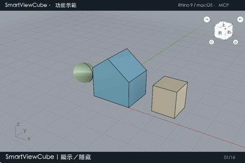

# ononSmartView

**Rhino 7、8、9 視圖導覽測試外掛 · macOS／Windows**
[English](README.md) · [下載 v0.2.0-beta.1](https://github.com/ZionW/ononSmartView/releases/tag/v0.2.0-beta.1)

> **此為測試版本，仍有疏漏、不足及未驗證之處。** 各 Rhino 主版本分別編譯。近期操作驗證與示範使用 macOS Rhino 9；本次新建置的 Rhino 7／8，以及所有 Windows 套件，尚未於對應的 Rhino 實機測試。重要模型請先儲存備份。

## 20 秒功能示範



使用 Mac Rhino 9 的實際視窗畫面，透過 MCP 指令與外掛回呼自動操作，加入中文字幕。包含顯示／隱藏、拖曳旋轉、選取物件中心旋轉、面／邊／角視角、投影切換、返回視角、C 工作平面跟隨，以及平面與曲面的 Focus／Flip／Back。GIF 無聲循環播放。[原尺寸 GIF 與 MP4](https://github.com/ZionW/ononSmartView/releases/tag/v0.2.0-beta.1)。

## 請選擇對應版本

| Rhino | 執行環境 | macOS | Windows |
| --- | --- | --- | --- |
| 7 | .NET Framework 4.8／Mono、AnyCPU | `rhino7-mac.macrhi` | `rh7_0-win.yak` 或 `rhino7-windows-rhp.zip` |
| 8.35+ | .NET 8、AnyCPU | `rhino8-mac.macrhi` | `rh8_35-win.yak` 或 `rhino8-windows-rhp.zip` |
| 使用 .NET 10 的 9 | .NET 10、AnyCPU | `rhino9-mac.macrhi` | `rh9_0-win.yak` 或 `rhino9-windows-rhp.zip` |

Rhino 9 套件以 SDK 9.0.26300.9402 編譯，需要使用 .NET 10 的 Rhino 9。上表顯示檔名尾碼，完整檔名另含版本號。**同一套 Rhino 只安裝對應主版本的套件。** 不包含較舊的 Rhino 8 或使用舊 .NET 執行環境的早期 Rhino 9 WIP。

## 功能

- 選取 Brep 面，設定工作平面，再以動畫切換至平行正視。平面直接使用平面座標；曲面使用選取點的切線座標。
- Back 還原正視前的攝影機、投影、目標、焦距與工作平面；Flip 翻轉觀看方向。
- 點擊 ViewCube 的面、邊、角可切換視角及平行／透視；拖曳可旋轉，左右箭頭可水平轉 90°。
- 旋轉動畫採圓弧路徑，保持旋轉半徑與焦距。單選物件使用其包圍盒中心；多選使用整組包圍盒中心；未選取時使用目前視圖目標點。此選取中心適用於 ViewCube 拖曳與旋轉按鈕。
- 小房子圖示：Perspective 回到本次 ViewCube 操作前記錄的視角；標準命名視圖回到預設方向並將可見物件納入視窗。
- 圓形 **C** 控制是否跟隨工作平面正對。點擊只切換設定，不立即移動攝影機。關閉時，選取物件或改變工作平面不會觸發外掛的自動正視；外掛不修改 Rhino Auto CPlane 的偏好設定。
- Rhino 7 沒有 Rhino 8 Auto CPlane；C 可跟隨手動／世界工作平面的改變。
- SmartView 工具列提供自訂立方體圖示，支援淺色／深色介面，點擊可顯示／隱藏 ViewCube。

## 指令

| 指令 | 動作 |
| --- | --- |
| `SmartViewCube` | 顯示／隱藏 ViewCube，取代舊指令 `ononSmartViewCube`。 |
| `ononSmartView` | 選取 Brep 面並正視。 |
| `ononSmartViewFlip` | 翻轉正視方向。 |
| `ononSmartViewBack` | 還原正視前的攝影機與工作平面。 |
| `ononSmartViewAutoFace` | 切換工作平面跟隨，等同 C 按鈕。 |
| `ononSmartViewFocusFace` | 腳本正視：依序輸入 Brep GUID、從零開始的面索引、視窗名稱。 |

工具列／快捷鍵巨集：`_SmartViewCube`。舊快捷鍵若使用舊名稱，請一併更改。

## macOS 安裝

1. 到 [Releases](https://github.com/ZionW/ononSmartView/releases/tag/v0.2.0-beta.1) 下載對應 Rhino 主版本的 `.macrhi`。
2. 關閉該 Rhino，移除本外掛的舊版本，再用指定 Rhino 開啟安裝檔。若同時裝有多版 Rhino，請使用「打開檔案的應用程式」選擇正確版本。
3. 重新啟動 Rhino；輸入 `SmartViewCube` 切換 ViewCube。

安裝包未簽署。包內包含 `ononSmartView.rui`；Rhino 8／9 若未顯示圖示按鈕，可從工具列設定開啟它，再顯示 **SmartView** 工具列。Rhino 7 Mac 的工具列自訂方式不同，可直接輸入指令或將 `_SmartViewCube` 設為快捷鍵。

## Windows 安裝

Rhino 7、8、9 均提供 **RHP 手動安裝 ZIP**：

1. 下載對應的 `rhinoN-windows-rhp.zip`，完整解壓縮至固定本機資料夾。
2. 若 Windows 檔案內容顯示「解除封鎖」，先解除封鎖下載的 ZIP／檔案。
3. 在對應 Rhino 執行 `PlugInManager` →「安裝」→ 選擇解壓縮後的 `ononSmartView.rhp`。不要從 ZIP 內直接開啟，安裝後不要移動該資料夾。
4. 如需圖示按鈕，從工具列設定開啟 `ononSmartView.rui`。

也可用對應 Rhino 的 Yak CLI 安裝 `.yak`。例如在 PowerShell 安裝 Rhino 7 版：

```powershell
& "$env:ProgramFiles\Rhino 7\System\Yak.exe" install "C:\Downloads\ononsmartview-0.2.0-beta.1-rh7_0-win.yak"
```

Rhino 8／9 請替換程式路徑與套件檔名。`.yak` 是套件，不是 RHP 或模型；拖曳若出現「不支援的類型」，請使用 CLI。切換 Yak 與手動安裝方式前，先移除舊副本並重新啟動 Rhino，避免重複載入。

## 編譯與封裝

本專案及版本化 source ZIP 提供原始碼。Rhino 8 使用 .NET 8 SDK，Rhino 9 使用 .NET 10 SDK，Rhino 7 使用 .NET Framework 4.8 參考組件套件。請選擇對應主版本的 RhinoCommon，不能用 Rhino 9 組件建立 Rhino 7／8 版。

```sh
dotnet build ononSmartView.csproj -c Release -p:RhinoVersion=9
# Rhino 7／8 改為 -p:RhinoVersion=7 或 8。
# 可用 -p:RhinoCommonPath=/絕對路徑/RhinoCommon.dll 指定 SDK。
```

Rhino 7 的預設 SDK 位置為 `work/rhino7-sdk/lib/net45/RhinoCommon.dll`，由官方 NuGet 套件 `RhinoCommon 7.0.20314.3001` 解壓縮取得。`scripts/package-release.py` 封裝三個已成功編譯的版本；`scripts/build-toolbar.py` 產生向量工具列圖示（需要 Pillow）。沒有使用 WPF 或 Windows Forms 介面。

## 測試與限制

- 近期版本曾在 Mac Rhino 9 透過 MCP 驗證固定半徑旋轉、焦距、選取中心與拖曳回呼。20 秒示範使用已安裝的 beta.6 功能。
- 本次以同一功能原始碼，針對各版 SDK 重新建置；這些確切發布檔的實機回歸測試仍待完成。
- Rhino 7／8 本次套件及所有 Windows 的實際操作均尚未驗證。較早的 Rhino 8.35 驗證不代表本次新發布檔已驗證。
- 原生工具列在各平台／版本的配置方式不同；未安裝雙擊曲面自動正視的手勢。

## 授權

尚未指定授權，預設保留所有權利。重新散布或修改前請先聯絡作者。
